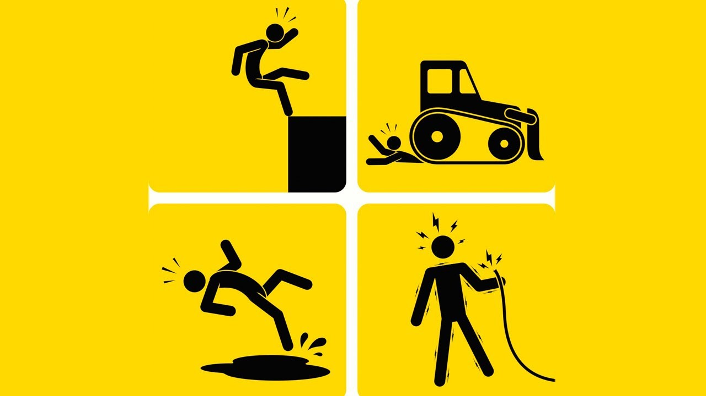
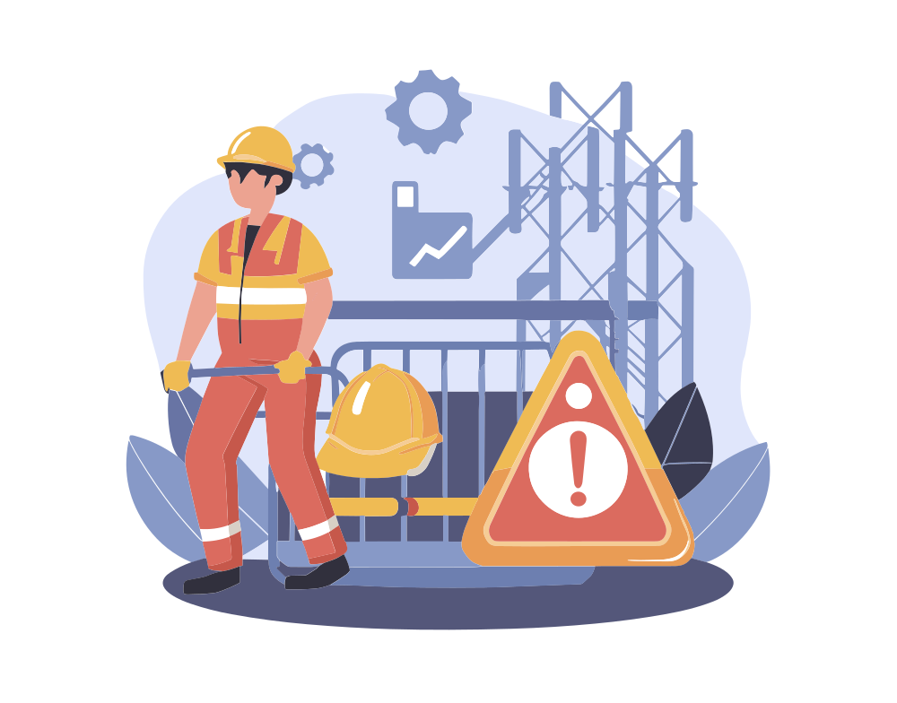
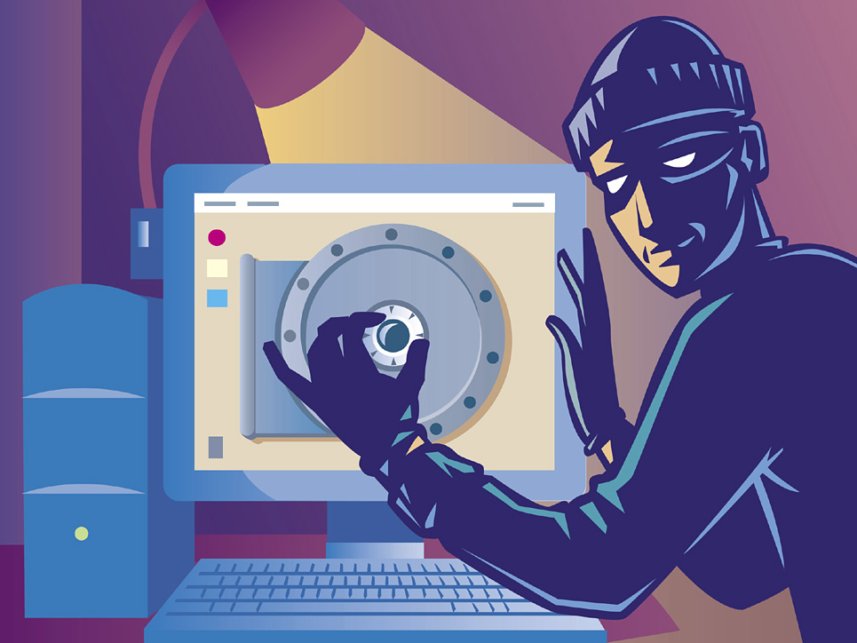

**SEGURIDAD EN EL TRABAJO**

**ÍNDICE**

1.Riesgos laborales

2.Prevención de riesgos desde un punto de vista informático

**1-Riesgos laborales**

Los riesgos laborales son aquellos peligros o situaciones que pueden provocar daños en la salud o la seguridad de una persona mientras realiza su trabajo. Pueden aparecer en cualquier profesión, desde trabajar en una oficina hasta realizar actividades en una fábrica, un hospital o una obra.

Estos riesgos no siempre provocan accidentes de forma inmediata, sino que también pueden causar enfermedades o problemas de salud que aparecen con el paso del tiempo.

Principales riesgos laborales:

Los riesgos laborales pueden ser de diferentes tipos. Algunos de los más importantes son:

* Riesgos físicos: están relacionados con el ruido, las temperaturas extremas, las vibraciones o una iluminación inadecuada.  
* Riesgos químicos: se producen por el contacto o la exposición a productos tóxicos, gases o sustancias peligrosas.  
* Riesgos biológicos: aparecen por la exposición a virus, bacterias y otros microorganismos que pueden provocar enfermedades.  
* Riesgos ergonómicos: están relacionados con las malas posturas, los movimientos repetitivos y el levantamiento de objetos pesados.  
* Riesgos psicosociales: incluyen el estrés, la ansiedad, la sobrecarga de trabajo y los conflictos laborales.

La prevención de riesgos laborales:

La prevención de riesgos laborales consiste en identificar los peligros que existen en un puesto de trabajo y tomar medidas para evitar que provoquen daños. Las empresas tienen la obligación de evaluar los riesgos y proteger a sus trabajadores mediante medidas de seguridad y formación.

Algunas medidas preventivas son utilizar equipos de protección adecuados, mantener el lugar de trabajo limpio y ordenado, respetar las normas de seguridad, utilizar correctamente las herramientas y realizar descansos cuando sea necesario.

Riesgos laborales en la informática:

En el ámbito de la informática, los riesgos más habituales están relacionados con pasar muchas horas delante de una pantalla y permanecer sentado durante largos periodos de tiempo. Esto puede provocar fatiga visual, dolores de espalda y cuello, molestias en las muñecas y problemas derivados del sedentarismo.

También puede aparecer estrés por la acumulación de tareas o por trabajar durante muchas horas sin descansar. Para evitar estos problemas, es importante utilizar una silla adecuada, mantener una buena postura, colocar correctamente la pantalla y realizar pausas para descansar la vista y moverse.

**2-Prevención de riesgos desde un punto de vista informático**

La prevención de riesgos informáticos es el conjunto de estrategias, herramientas, normativas y hábitos diseñados para identificar, evaluar y minimizar las vulnerabilidades que pueden afectar a los equipos, redes, programas y datos de un usuario o de una organización.

El objetivo de prevenir estos riesgos es proteger tres pilares fundamentales de cualquier sistema informático, conocidos como la Tríada CIA:

* **Confidencialidad:** Garantizar que la información solo sea accesible para las personas o sistemas autorizados.  
* **Integridad:** Asegurar que los datos no sean alterados, borrados o manipulados de forma indebida o accidental.  
* **Disponibilidad:** Mantener los sistemas y la información operativos y accesibles siempre que los usuarios legítimos los necesiten.

## Principales Amenazas y Vulnerabilidades

Para prevenir un riesgo de forma eficaz, primero hay que identificar de dónde procede. En informática, las amenazas se agrupan en tres grandes categorías:

### **Amenazas de software y red (Ciberataques)**

* ***Ransomware*** **(secuestro de datos):** Programa malicioso que cifra los archivos del equipo y exige un rescate económico para devolver el acceso.  
* **Virus, troyanos y *spyware*:** Software diseñado para dañar el sistema, abrir puertas traseras al atacante o espiar contraseñas y actividad sin permiso.  
* **Ataques de denegación de servicio (DDoS):** Saturación de un servidor o página web mediante millones de peticiones simultáneas hasta dejarlo fuera de servicio.  
* **Intercepción de comunicaciones:** Espionaje o robo de datos cuando se navega por redes Wi-Fi públicas o sin cifrar.

### **El factor humano (Ingeniería social y errores)**

* **Ingeniería social y *phishing*:** Engaños mediante correos, mensajes o llamadas falsas que suplantan a bancos o empresas para robar contraseñas y datos bancarios.  
* **Gestión deficiente de credenciales:** Uso de contraseñas débiles, predecibles o repetidas en varios servicios distintos.  
* **Descuidos cotidianos:** Borrar archivos por error, dejar sesiones abiertas en ordenadores compartidos o conectar memorias USB de origen desconocido.

### **Fallos físicos y del entorno**

* **Averías de hardware:** Fallos por desgaste o defectos en discos duros, fuentes de alimentación o placas base.  
* **Problemas eléctricos y ambientales:** Apagones, subidas de tensión, sobrecalentamiento de servidores, incendios o inundaciones.  
* **Robo o extravío:** Pérdida física de portátiles, móviles o discos externos con información sin proteger.

## Medidas Preventivas: Técnicas y Organizativas

Una buena prevención combina herramientas tecnológicas con buenos hábitos por parte de los usuarios:

### **Barreras técnicas y de software**

* **Actualizaciones constantes:** Instalar parches de seguridad en sistemas operativos y aplicaciones para cerrar fallos conocidos.  
* **Control de accesos y doble factor (2FA):** Usar contraseñas largas y únicas junto con un segundo código de verificación enviado al móvil.  
* **Cifrado de datos:** Codificar discos duros y comunicaciones (mediante HTTPS o VPN) para que nadie pueda leer la información si la intercepta o roba el equipo.  
* **Defensa perimetral:** Utilizar cortafuegos (*firewalls*), antivirus actualizados y filtros *antispam* para bloquear ataques y correos fraudulentos.  
* **Protección eléctrica y física:** Contar con sistemas SAI frente a cortes de luz y restringir el acceso físico a los servidores.

### **Medidas organizativas y hábitos de seguridad**

* **Copias de seguridad (*Backups*):** Aplicar la **regla 3-2-1**: tener 3 copias de los datos, en 2 soportes distintos y al menos 1 fuera de la oficina o en la nube desconectada.  
* **Principio de mínimo privilegio:** Limitar los permisos de cada usuario únicamente a los archivos y programas que necesita para trabajar.  
* **Segmentación de redes:** Separar la red interna de trabajo de la red Wi-Fi de invitados para evitar que un fallo se propague.  
* **Formación y concienciación:** Educar a los usuarios para detectar intentos de *phishing*, verificar enlaces antes de hacer clic y evitar descargas no oficiales.

## **4\. Gestión de Incidentes y Continuidad del Negocio**

Dado que el riesgo cero no existe en informática, una parte esencial de la prevención consiste en tener preparado un protocolo para actuar rápido si ocurre un problema grave:

1. **Detección y contención:** Identificar el fallo o ataque lo antes posible y aislar los equipos afectados (por ejemplo, desconectándolos de la red) para evitar que el problema se propague a otros ordenadores.  
2. **Erradicación y recuperación:** Eliminar la causa del incidente (limpiar el *malware*, sustituir el hardware dañado o cerrar la brecha de seguridad) y restaurar los sistemas utilizando las copias de seguridad limpias.  
3. **Análisis posterior y mejora:** Investigar qué falló, documentar lo ocurrido y actualizar las medidas preventivas para evitar que el mismo incidente vuelva a repetirse en el futuro.

